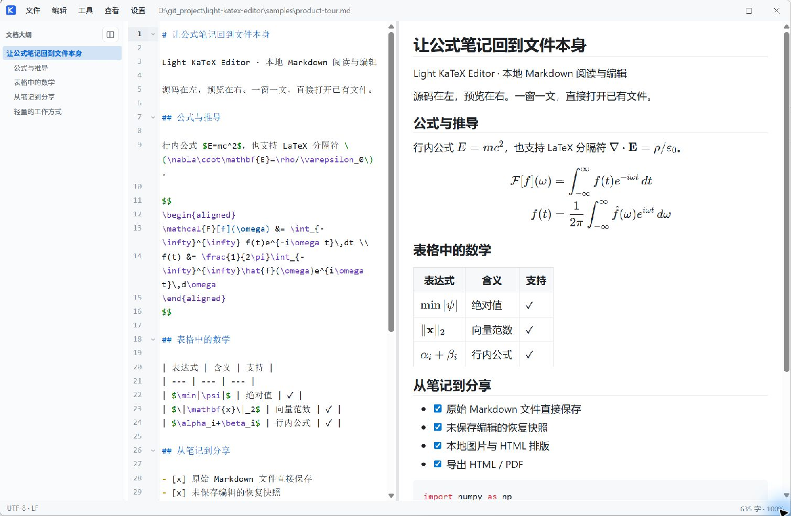
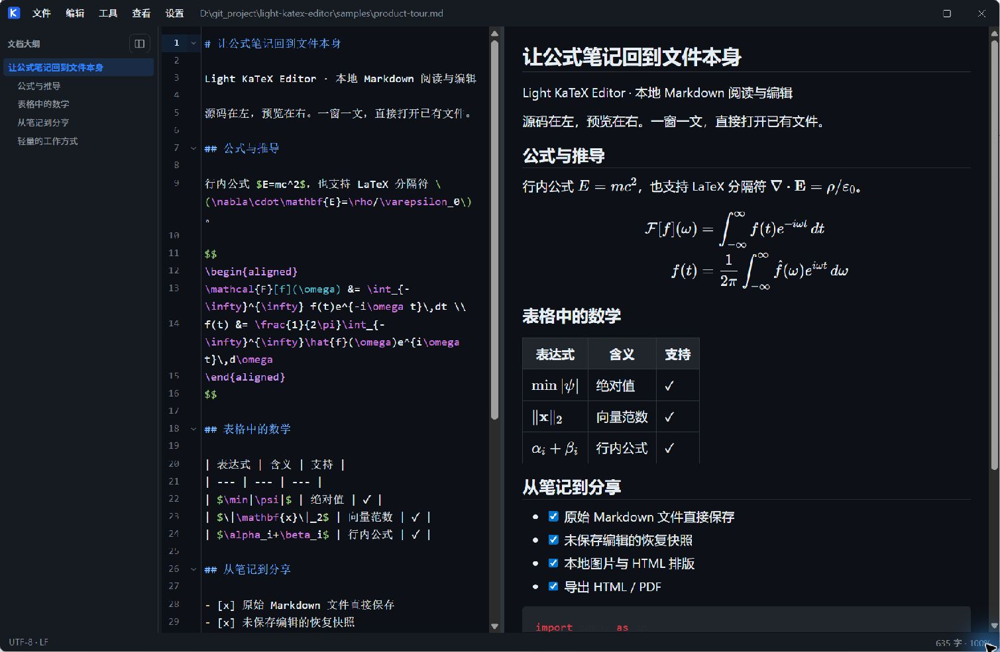
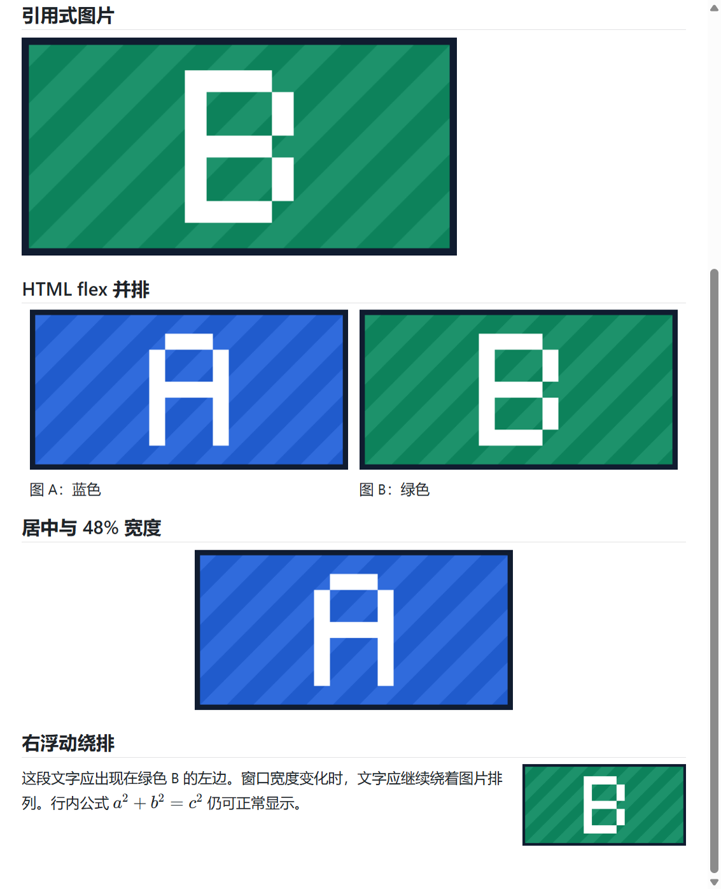

# Light KaTeX Editor

轻量本地 Markdown 阅读 / 编辑器。左侧编辑原始源码，右侧实时预览公式与排版，一窗一文，直接使用现有文件。

**[下载 Windows x64 安装版 v0.1.6](https://github.com/oopjoy/Light-KaTeX-Editor/releases/download/v0.1.6/LightKaTeXEditor-0.1.6-Setup.exe)** · [更新说明](https://github.com/oopjoy/Light-KaTeX-Editor/releases/tag/v0.1.6) · [公式演示文档](samples/product-tour.md)



文档大纲定位章节，源码与预览并排；支持多行公式、表格中的绝对值与范数，以及 HTML / PDF 导出。

<details>
<summary>查看深色主题</summary>



</details>

<details>
<summary>查看本地图片、并排、居中和浮动排版</summary>



对应文档：[图片排版示例](samples/image-regressions.md)。截图来自实际运行的应用。

</details>

## v0.1.6：保存更稳，恢复更完整

- 保存先完整写入临时文件，再替换目标；失败时保留原文。
- 编辑中定期生成恢复快照，连续输入也会保存；异常退出后重新打开文件可选择恢复。
- 保存、撤销、另存为和关闭按顺序清理快照，避免过期恢复内容重新出现。
- 主编辑器、预览和 PDF 窗口启用 sandbox；统一 Markdown 扩展名，补充真实 Electron 回归与大文档基准。

详见 [v0.1.6 发布记录](docs/releases/v0.1.6.md)。

## 下载与安装

**Windows 用户推荐下载 [最新完整安装版](https://github.com/oopjoy/Light-KaTeX-Editor/releases/latest)**，选择 `LightKaTeXEditor-版本号-Setup.exe`。

安装包内置 Electron 和全部运行依赖，**无需安装 Node.js，也无需下载源码**。安装向导支持选择安装目录、创建桌面和开始菜单快捷方式，并提供卸载入口；安装后直接启动，不再每次自解压。不会修改 Markdown 默认打开程序。旧版 portable 仍保留在历史 Releases 中。

安装包目前未进行代码签名，Windows SmartScreen 可能提示未知发布者。请核对仓库来源和发布页的 SHA-256 校验值后再决定是否运行。

主要功能：

- 直接打开和保存现有 `.md` 文件
- 左侧 CodeMirror 6 源码编辑
- 右侧 markdown-it + KaTeX 实时预览
- 支持行内 `$...$`、`\(...\)`，以及单行或多行块公式 `$$...$$`、`\[...\]`
- 保留 LaTeX 原始分隔符；代码片段、代码块和转义后的分隔符不会被误解析为公式
- 配置保存在应用用户目录，不写入文档目录
- 无 Vault、无数据库、无所见即所得内部文档模型

## 源码运行要求

以下要求仅适用于开发和源码运行；Windows x64 安装版不需要 Node.js。

- Node.js 20+
- Windows / macOS / Linux

## 安装

```bash
git clone https://github.com/oopjoy/Light-KaTeX-Editor.git
cd Light-KaTeX-Editor
npm install
```

## 开发运行

```bash
npm run dev
```

## 生产构建

```bash
npm run build
npm start
```

## 窗口模型

**一窗一文**：每个窗口只绑定一个 Markdown 文件。

- 点 **打开** / `Ctrl+O`：始终在**新窗口**打开所选文件
- 点 **新窗口** / `Ctrl+Shift+N`：新建空窗口
- 命令行传入多个 `.md`：每个文件各开一个窗口
- 若该文件已在某窗口打开：聚焦已有窗口，不重复开窗

## 注册到 Windows「打开方式」

只添加 Open with 条目，**不会**改默认打开程序：

```bash
npm run register-open-with
```

之后可对 `.md` 右键 → 打开方式 → Light KaTeX Editor。

取消注册：

```bash
npm run unregister-open-with
```

## 双向跳转

- **双击预览**中的段落 / 标题 / 公式 / 代码块 → 源码跳到对应行
- **源码区右键** →「跳转到预览」→ 预览滚动到对应块并高亮

映射粒度是块级（基于 `data-source-line`），不是字符级。

## 快捷键

| 快捷键 | 功能 |
| --- | --- |
| `Ctrl+O` | 打开（新窗口） |
| `Ctrl+Shift+N` | 新建空窗口 |
| `Ctrl+S` | 保存 |
| `Ctrl+Shift+S` | 另存为 |
| `Ctrl+Z` | 撤销（与“编辑 → 撤销”共用源码历史） |
| `Ctrl+Y` / `Ctrl+Shift+Z` | 重做 |
| `Ctrl+F` | 查找 |
| `Ctrl+H` | 替换 |
| `Ctrl+,` | 设置（主题 / 字体 / 字号 / 行距） |
| `Ctrl+=` / `Ctrl+-` | 增大 / 减小字号 |
| `Ctrl+0` | 重置字号 |
| `Ctrl+T` | 切换主题 |
| `F11` / `Esc` | 全屏 / 退出全屏 |

菜单：**文件 → 最近打开**，**编辑 → 查找/替换**，**设置 → 外观与字体**，**设置 → 主题 → 浅色/深色**，**查看 → 增大/减小/重置字号**。

源码与预览始终铺满各自栏位，不再限制正文最大宽度；旧版保存的最大宽度会自动忽略。可拖动中间分隔条调整分栏比例，正文保留正常内边距。

## 本地图片与文件链接

- 图片支持相对文档目录的路径、Windows 绝对路径及 `file:///` URL；含空格的 Markdown 目标请用 `<...>` 包裹。
- Windows 绝对路径按文件名处理（包括字面 `%`、`#`）；相对 URL 中的文件名 `#`、`%` 请写成 `%23`、`%25`，已有的 URL 编码不会重复编码。
- 点击 Preview 中的本地文档或文件夹链接，会使用系统默认程序打开，不强制在编辑器内打开；可执行文件和脚本需要额外确认。
- 预览、HTML 和 PDF 导出共用资源路径解析。HTML 引用本地文件时仍依赖原文件的位置，不会自动复制图片。

## 公式辅助

- **错误列表**：窗口底部列出无法解析的 `$...$` / `$$...$$` / `\(...\)` / `\[...\]`，点击跳到源码行
- **补全提示**：在公式内输入 `\` 后自动提示常用 KaTeX 命令（希腊字母、分数、极限、环境等）；`Ctrl+Space` 可手动触发

### 表格中的数学竖线

表格单元格中的行内数学可直接使用绝对值和范数，无需为表格改写 LaTeX：

```md
| $t$ | $\min|\psi|$ | raw winding |
| --- | --- | --- |
| $1$ | $\|\psi\|$ | norm |
| $2$ | \( \left|x\right| \) | absolute value |
```

支持 `$...$` 和 `\(...\)` 中的竖线；`\|` 的反斜杠和范数语义会保留。保护仅发生在表格解析期间，不修改磁盘源码；全文/局部预览、HTML/PDF 导出共用同一解析规则。

表格仍遵循一行对应一条物理 Markdown 行的规则：不支持在单元格中放跨行展示公式，也不将 `$$...$$` 扩展为单元格行内语法。数学外的竖线、代码 span 和围栏保持原有 Markdown 规则。

## 保存与恢复

- 保存按钮和 `Ctrl+S` 的外观不变，但内部先写入同目录临时文件，完整写入后再替换目标文件。
- 已打开文件的未保存修改会定期写入 `%APPDATA%\light-katex-editor\recovery\`。正常保存、明确放弃修改或关闭干净文档后删除快照。
- 下次打开同一文件时，如快照与磁盘内容不同，会询问是否恢复；恢复不会自动覆盖磁盘文件。
- 打开方式、命令行和文件对话框使用同一份 Markdown 扩展名清单：`config/markdown-extensions.json`。

替换文件失败时会报告保存失败并保留原文件，不会先删除原文件。编辑中的恢复快照每约 1.8 秒写入一次，连续输入不会推迟；撤销至已保存内容、另存为及正常关闭会清理对应快照，清理与正在进行的快照写入按顺序完成。

## 本地验收与性能记录

- `npm test`：类型检查、Markdown/公式回归、资源路径，以及写入、同步和替换失败时保留原文的测试。
- `npm run test:desktop`：重新构建，运行完整 Electron 回归、恢复提示、持续输入快照、撤销、另存为、慢磁盘竞争、关闭以及异常退出后重开的恢复测试。
- `npm run benchmark:large`：在真实应用中测量 5000 行 Markdown、1000 个公式、800 行表格及 300 张本地图片的首次打开、输入响应、输入到预览和全文刷新。等待字体与图片加载后记录，结果保存到 `reports/benchmark-latest.json`；单次结果包含 IPC 和轮询开销，不是稳定性能阈值。请先运行构建或桌面回归。
- 人工图片验收打开 `samples/image-regressions.md`，蓝色 A 和绿色 B 都是 480 × 240 的可见 PNG，覆盖引用式图片、并排、居中与浮动。`node scripts/create-image-samples.mjs` 可重新生成图片。

## 设计原则

源码始终是唯一数据源：

```text
Markdown 源码 → 只读 HTML 预览
```

保存时写回编辑器中的原始字符串，预览结果不参与序列化，因此 `$$\alpha$$` 不会被改写成三行形式，`\(...\)` / `\[...\]` 也不会被替换成美元符号分隔符。

## 配置目录

Windows：

```text
%APPDATA%\light-katex-editor\config.json
```

仅保存最近文件、窗口尺寸、主题、字体大小、分栏比例等。


## Windows 安装包构建

默认构建完整离线 NSIS 安装包（Windows x64）：

```bash
npm ci
npm test
npm run dist
```

产物：

```text
release/LightKaTeXEditor-0.1.6-Setup.exe
```

安装版使用固定安装目录，包含运行时、应用资源和卸载程序。默认按当前用户安装，支持自选路径；卸载不删除用户配置或文档。

如需原来的自解压单文件便携版：

```bash
npm run dist:portable
```

也可只生成未压缩目录（调试用）：

```bash
npm run dist:dir
# release/win-unpacked/Light KaTeX Editor.exe
```

说明：

- 配置仍写在 `%APPDATA%\light-katex-editor\`，不会进压缩包
- 安装包尚未签名，首次运行可能收到 Windows SmartScreen 提示；请确认来源与校验值
- 包体包含完整 Electron 运行时，安装后占用数百 MB 属正常情况

## 许可证

[MIT](LICENSE)
